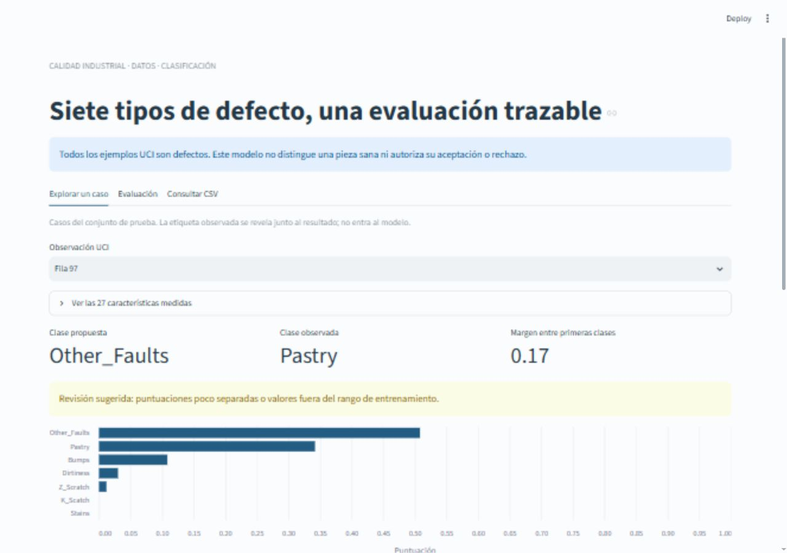

# Steel Defect Study

**Clasificar el tipo de defecto, mostrar los errores por clase y señalar cuándo revisar el resultado.**

Python · scikit-learn · Streamlit · UCI

Reconstrucción del experimento con la fuente oficial: 1.941 observaciones, 27 características y siete tipos de defecto. No hay clase sana. La aplicación trabaja con características medidas y no con imágenes.

**Estado:** demostrador local validado, 11 pruebas aprobadas y CI en Python 3.11/3.13. Incluye revisión real de carga/exportación CSV y diseño móvil. [Evidencia y alcance de la validación](docs/VALIDATION.md). La versión anterior queda preservada en Git.



## Ejecutar

Con Python 3.11–3.14 y uv:

```bash
git clone https://github.com/GzoC/SteelPlatesFaultsClassification.git
cd SteelPlatesFaultsClassification
uv sync --locked --extra dev
uv run --no-sync steel-faults train
uv run --no-sync steel-faults dashboard
```

Abre http://127.0.0.1:8501. Puedes explorar casos reservados, comparar la clase propuesta con la observada, revisar puntuaciones y cargar un CSV de hasta 100 filas con las 27 características del ejemplo descargable. Las etiquetas no entran al modelo. El CSV se procesa localmente sin guardarlo en disco.

Recorrido de dos minutos: revisa la fila 97, donde el modelo se equivoca y sugiere revisión; cambia a la fila 169, correctamente clasificada. La fila 1662 muestra un error **sin** marca de revisión: la regla no garantiza certeza. En **Evaluación**, compara los modelos y sus errores por clase. En **Consultar CSV**, descarga el ejemplo, cárgalo y exporta sus siete resultados. Los ejemplos representan una observación por clase, elegida por orden de partición sin filtrar aciertos.

## Resultado medido

El modelo se eligió por macro-F1 de validación, antes de consultar el test. En las 389 observaciones reservadas:

| Método | Macro-F1 | Accuracy |
|---|---:|---:|
| Clase mayoritaria | 0,0736 | 0,3470 |
| Regresión logística | 0,6635 | 0,6530 |
| Random Forest | 0,8080 | 0,7789 |

Las clases no tienen igual desempeño: F1 de Bumps es 0,6667 y de Pastry 0,6780. Dirtiness solo tiene 11 ejemplos de prueba. La regla de puntuación/margen marca 169 casos para revisión; no garantiza certeza en los restantes. [Informe generado con métricas por clase y límites](reports/RESULTS.md).

## Decisiones de diseño

- Pipeline persistido: transformaciones ajustadas solo sobre entrenamiento; separación estratificada 60/20/20 y semilla fija.
- Comparación con una referencia mayoritaria y un modelo lineal. Selección por macro-F1 para considerar clases minoritarias. No se usa SMOTE.
- Contrato estricto de 27 entradas, valores finitos, geometría coherente y tipo de acero exclusivo. Orden de columnas normalizado.
- Puntuaciones sin calibración, margen entre clases y aviso fuera de rango. Importancia global por permutación calculada en validación.
- Hash de datos y modelo, versión de scikit-learn, particiones y métricas guardados con el artefacto.

## Reproducir

```bash
uv run --no-sync pytest
uv run --no-sync ruff check src tests scripts
uv run --no-sync python scripts/publish_report.py
uv run --no-sync python scripts/check_notebook.py
uv build
```

El entrenamiento crea var/model. El informe se genera desde su manifiesto y el notebook llama al mismo entrenamiento y predictor. Solo carga artefactos locales confiables; un checksum detecta corrupción, no autentica modelos de terceros.

[Fuente y licencia de datos](data/README.md) · [Modelo y límites](docs/MODEL_CARD.md) · [Resultados completos](reports/evaluation.json).

No puede estimarse aceptación/rechazo de piezas con un dataset que solo contiene defectos. Tampoco se acredita generalización a otras plantas o lotes sin sus identificadores. Las limitaciones forman parte de la evaluación.

English: Reproducible seven-class steel defect study with per-class evaluation, local inference and explicit review flags. No healthy class or industrial deployment is claimed.

Autor: [GzoC](https://github.com/GzoC). Código MIT. Datos: Buscema, Terzi y Tastle (2010), UCI Steel Plates Faults, DOI 10.24432/C5J88N, CC BY 4.0.
